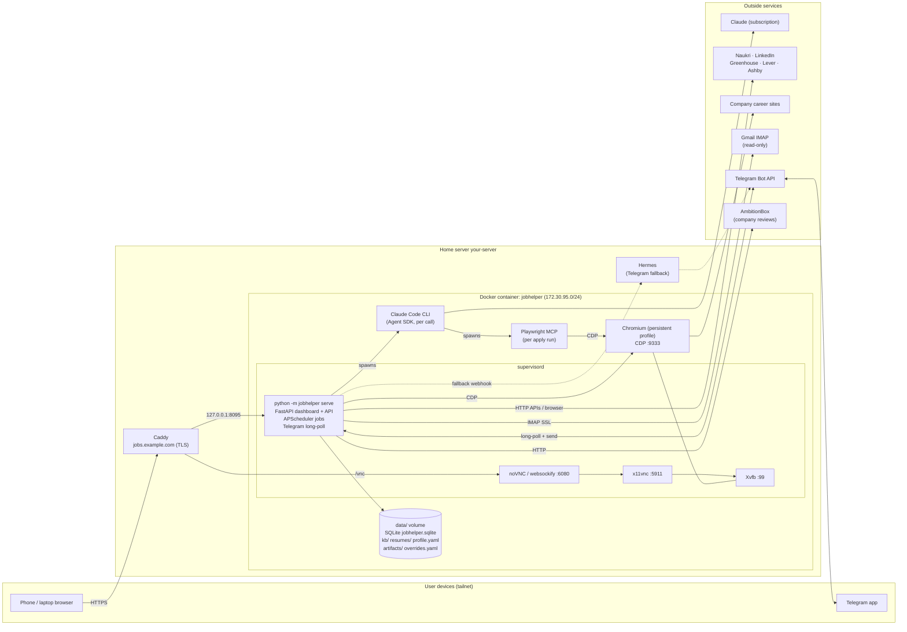
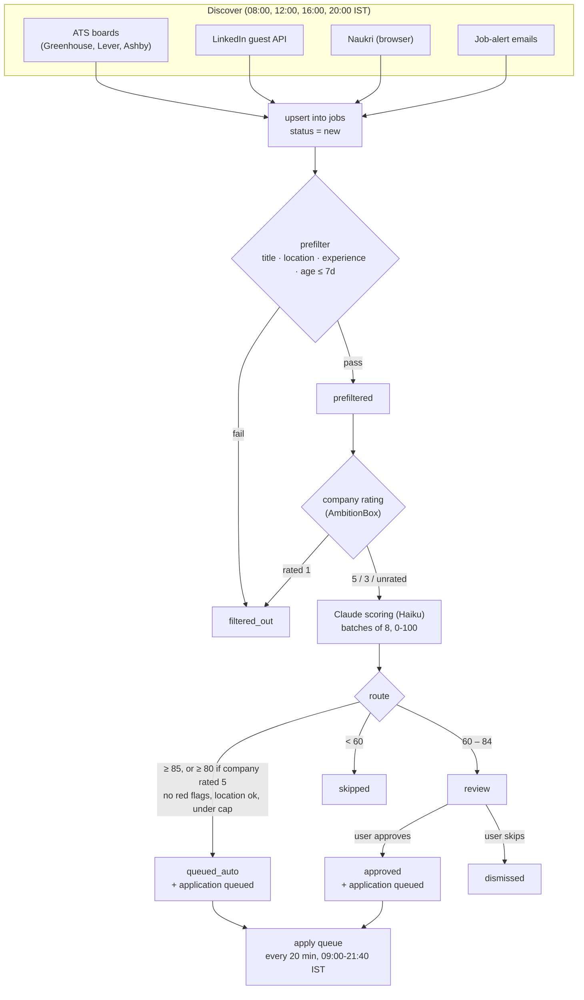
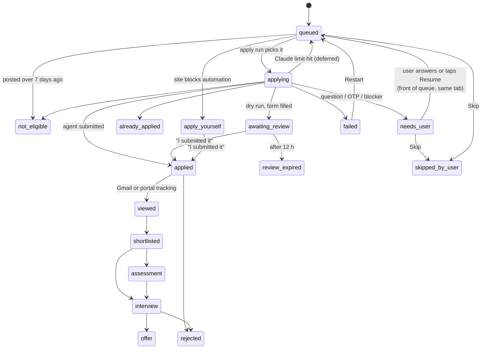
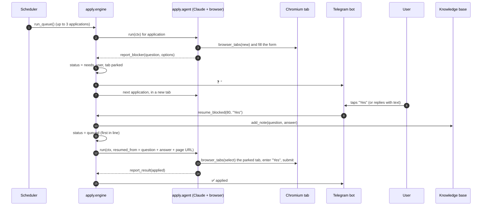
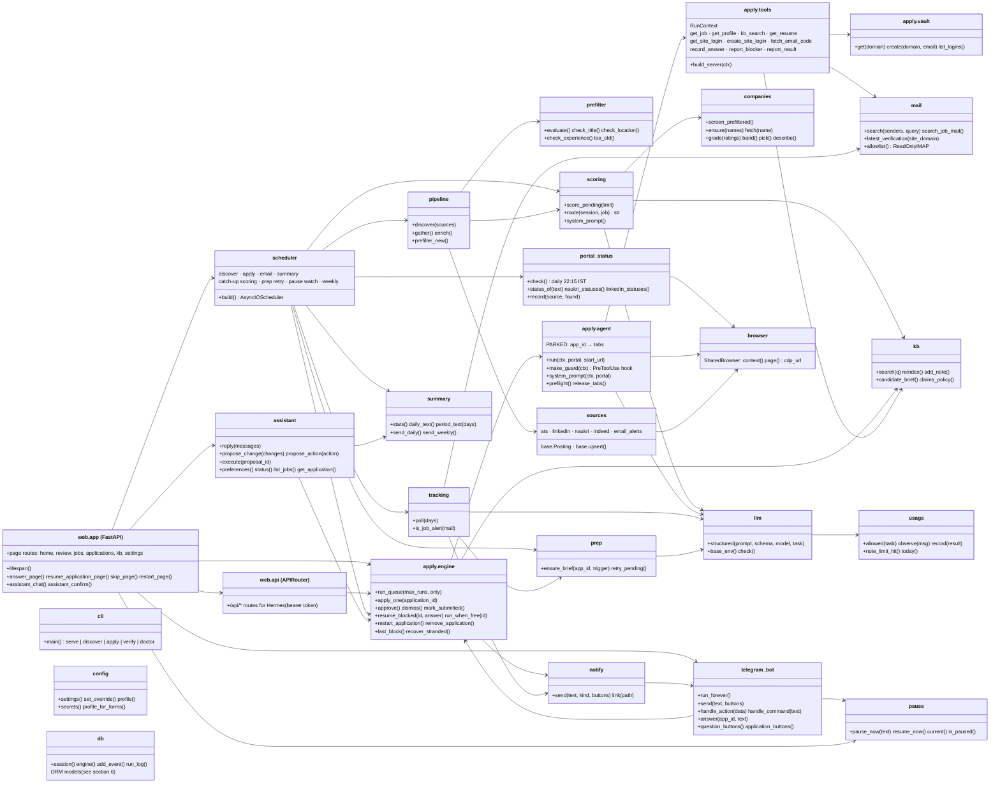
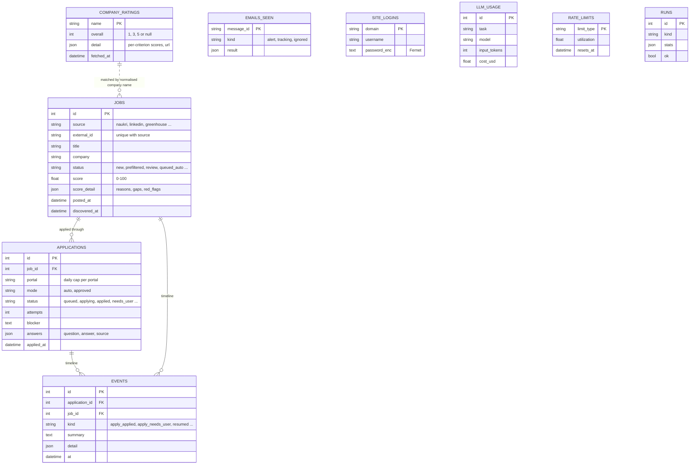

# JobHelper architecture and design

JobHelper finds jobs, scores them against the candidate's knowledge base, applies to the best
ones through an AI agent driving a real browser, tracks replies in Gmail, and keeps the user in
the loop through a dashboard and a Telegram bot. It runs as one Docker container on the home
server `your-server` and uses the user's Claude subscription.

## 1. System architecture

Everything JobHelper runs is inside one container. The user reaches it over the tailnet through
Caddy; the outside services it talks to are on the right.

Key points:
- **One process does the work** (`app`): web server, scheduler and Telegram bot share one asyncio loop.
- **One shared browser.** Discovery, the apply agent and the user (through noVNC) all use the same
  logged-in Chromium. Each application gets its own tab; a stuck one keeps its tab open.
- **Claude runs through the Agent SDK**, which starts the Claude Code CLI with the subscription token.
  Scoring and email triage are one-shot calls with no tools; the apply agent gets the browser
  (Playwright MCP) and JobHelper's own tools, behind a guard hook.
- **Gmail is read-only and allowlisted**: only job platforms and companies applied to.

## 2. Job pipeline

## 3. Application lifecycle

## 4. A stuck application, end to end

## 5. Module design

Each box is a Python module (or class) with its main public functions. Arrows point from a module
to the modules it calls.

Everything also uses `config` (settings, profile, secrets) and `db` (SQLite); those arrows are left
out to keep the picture readable.

## 6. Data model

Full column list: [database-schema.md](database-schema.md).

## 7. Guardrails and where they live

| Guardrail | Enforced in |
|---|---|
| Gmail is read-only; only allowlisted senders are read; never reply or delete | `mail.ReadOnlyIMAP`, `mail.allowlist()`, `mail.NEVER_AUTO` |
| Platform / ATS mail is trusted; company mail is opened only when the subject is about a job | `mail.trusted_senders()`, `mail.JOB_SUBJECT` |
| Apply agent: no webmail, no Google/Apple/Microsoft sign-in, only the chosen resume uploaded, own tab only, no closing tabs | `apply.agent.make_guard` (PreToolUse hook, holds whatever the model decides) |
| Apply agent: no internal/private addresses or non-web URLs; no portal messaging or profile pages | `apply.agent.is_internal`, `apply.agent.PORTAL_OFF_LIMITS` |
| OTPs and saved logins only for this job's sites; passwords masked in logs | `apply.tools.RunContext.site()` / `own_url()`, transcript masking in `apply.agent` |
| Secrets never reach the browser or the Claude CLI (except the Claude token) | `browser.child_env()`, `llm.base_env()` |
| Dashboard: same-origin form posts, login lockout, strict CSP on prep pages | `web.app.same_origin_only`, `web.app.login`, prep route |
| Agent has no file or shell tools; only the browser + JobHelper tools | `apply.agent.run` (`tools=[]`, allowlist) |
| Claims policy: no invented numbers, no salary ranges, no personal projects in applications | `data/kb/claims-policy.md`, injected into every prompt |
| Claude usage: background work pauses at 60%, applying at 75%, email at 95%; max apply runs per day | `usage.allowed` (checked inside the LLM semaphore) |
| Chat assistant can only propose; nothing changes until the user taps Confirm | `assistant.propose_*` / `assistant.execute` |
| Telegram bot answers only the paired chat | `telegram_bot._handle_update` |
| Daily cap per portal, 7-day job age, company rated 1 dropped | `scoring.route`, `prefilter.too_old`, `companies.screen_prefiltered` |
